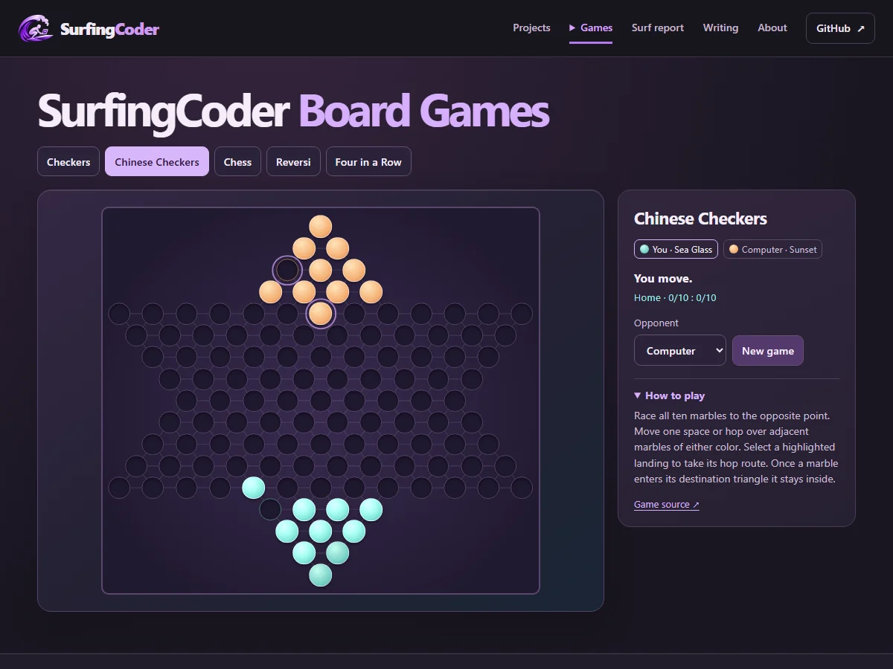

# SurfingCoder Board Games

Play [SurfingCoder Board Games](https://surfingcoder.com/board-games/) in your browser with amethyst boards and Sea Glass and Sunset pieces.



Pick a game, then choose **Computer** or **Two players**. In two-player mode, take turns on the same device. Use **New game** to reset the selected board. The game picker keeps each board in memory while the page is open. Use the arrow keys to move between squares and press Enter or Space to select.

| Game | How to win |
| --- | --- |
| Checkers | Capture every opposing piece or leave the opponent without a move. Captures and chains are compulsory. Promotion ends your turn. This version automatically draws after three repetitions or 80 half-moves without a capture or man move. |
| Chinese Checkers | Move all ten marbles into the opposite triangle. Play the two-player version on the full star. Take one step or a chain of hops, and keep marbles in the destination triangle once they enter. |
| Chess | Checkmate the opponent. Includes castling, en passant, the four promotion choices, and automatic draw detection. |
| [Othello](https://surfingcoder.com/board-games/#othello) | Finish with the most discs. A player with no legal move passes. The game ends when neither can play. |
| Four in a Row | Drop discs to connect four horizontally, vertically, or diagonally. |

[Checkers screenshot](docs/checkers.webp) · [Chess screenshot](docs/chess.webp) · [Othello screenshot](docs/othello.webp) · [Four in a Row screenshot](docs/four-in-a-row.webp)

## Run locally

Serve the repository with Python 3 and visit [http://127.0.0.1:8000/](http://127.0.0.1:8000/).

```sh
python -m http.server 8000 --bind 127.0.0.1
```

The games run entirely in the browser and require no accounts or network services once loaded. Run `node --test` with Node.js 22 or newer to test the game rules.

Chess rules use [chess.js 1.4.0](https://github.com/jhlywa/chess.js/tree/v1.4.0), distributed with its [BSD-2-Clause license](vendor/chess-LICENSE.txt). The browser opponent is implemented in this project.
